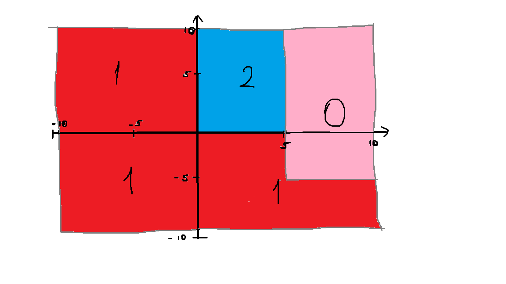

# Языки программирования
## Лабораторная работа 8

### Задание 1 **(2)**
*Рассмотрим программу на языке* **Python**.
```
x = [int(t) for t in input().split()]
for i in range(len(x)):
   if x[i] < i or x[i] > 2*i:
      break
print(i)
```
*Перепишите эту программу так, чтобы в ней использовался цикл* **while**, *в ней не использовалась
инструкция* **break**, *а используемый алгоритм не изменился. Полученная программа должна иметь следующий 
вид.*
```
x = [int(t) for t in input().split()]
i = 0
while ...:
   i += 1
print(i)
```
*Допишите правильное логическое выражение вместо многоточия. Выражение не должно содержать оператор* **not**.

### Задание 2 **(2)**
*Рассмотрим программу на языке* **Python**.
```
x = [int(t) for t in input().split()]
for i in range(len(x)):
   if i <= x[i] < 2*i or 3*i <= x[i] < 4*i:
      break
print(i)
```
*Перепишите эту программу так, чтобы в ней использовался цикл* **while**, *в ней не использовалась
инструкция* **break**, *а используемый алгоритм не изменился. Полученная программа должна иметь следующий 
вид.*
```
x = [int(t) for t in input().split()]
i = 0
while ...:
   i += 1
print(i)
```
*Допишите правильное логическое выражение вместо многоточия. Выражение не должно содержать оператор* **not**.


### Задание 3 **(2)**

*Напишите пример программы на* **Java** *с двумя вложенными циклами и инструкцией* **break** *для выхода
из двух вложенных циклов. В качестве такой программы можно взять поиск первого нуля в двумерном массиве.*

### Задание 4 **(2)**

*Рассмотрим программу на языке* **Python**.
```
a = list(range(10))
b = [a.pop() - x for x in a]
print(*b)
```
*Объясните, почему список* **b** *получился именно таким.*

**ОТвет:**
программа выводит 9 7 5 3 1.
Цикл берет элементы по порядку с начала, то есть слева, а a.pop() в этот же момент забирает элементы с конца, то есть справа. Они идут навстречу друг другу.
Если рассмотреть по шагам, то будет так:

* Шаг 1: x = 0, pop забрал 9. Вычитаем: 9 - 0 = 9
* Шаг 2: x = 1, pop забрал 8. Вычитаем: 8 - 1 = 7
* Шаг 3: x = 2, pop забрал 7. Вычитаем: 7 - 2 = 5
* Шаг 4: x = 3, pop забрал 6. Вычитаем: 6 - 3 = 3
* Шаг 5: x = 4, pop забрал 5. Вычитаем: 5 - 4 = 1

После этого список a закончился, элементы для шага 6 кончились, цикл остановился.
Результат уменьшается на 2 на каждом шаге, потому что x растет на 1, а число из pop уменьшается на 1.


### Задание 5 **(2)**

*Напишите программу на С++, которая прочитает натуральное число* **n**, *создаст вектор
из* **n** *элементов, прочитает значения элементов, добавит последний элемент вектора к каждому элементу 
(в том числе и к последнему), найдет и выведет количество положительных и отрицательных элементов вектора
после изменения. Из циклов в программе можно использовать только циклы по коллекции.*


### Задание 6 **(3)**

*Представим, что в некотором будущем стандарте* **С++** *появится конструкция*
```
forc(i, from, to)
```
*которая будет раскрываться в следующий код.*
```
{
   int __i = from, __n=to;
   for(const int &i= __i; i < __n; __i++) {
      ...
   }
}
```
*Чем эта конструкция отличается от стандартного цикла* **for**? *Укажите два основных различия.
Напишите программы для демонстрации этих различий.*

*Написанные программы сохраните в папку с номером задания.*

**Ответ:**

* Различие 1: Счётчик i менять нельзя, в forc переменная i это const int &, то есть константная ссылка на __i, в обычном for счётчик менять можно, и цикл от этого пойдёт по-другому.
* Различие 2: Граница to считается один раз, в forc значение to записывается в __n до начала цикла и больше не пересчитывается, в обычном for условие проверяется на каждой итерации, поэтому если n изменится внутри цикла, число повторений изменится

Вывод первого примера:

* obychny for: 0 2 4 6 8
  forc: 0 1 2 3 4 5 6 7 8 9

Вывод второго примера: 

* obychny for: 0 1 2
  forc: 0 1 2 3 4

### Задание 7 **(2)**

*Напишите программу на языке* **Python** *для проверки того, что все числа во введенной 
последовательности неотрицательные. Если в цикле будет найдено отрицательное число, цикл должен
прерваться и вывести найденное число. Если отрицательных чисел нет, то вывести некоторое сообщение об этом.*

*Программа должна использовать конструкцию* **for break else**.

*Запишите аналогичную программу на С++. Какие изменения в алгоритме решения в ней появились?. Почему?*

*Написанные программы сохраните в папку с номером задания.*

**Ответ:**

В с++ нет конатрукции for ... else, поэтому пришло добавить флаг переменную found, перед началом цикла она false, когда находим отрицательное число она меняется на true и цикл прекращается через break, после цикла проверяем флаг, если он так и осталься false, значит отрицательных числе нет. в пайтоне это все делается автоматически с помощью else.

### Задание 8 **(2)**

*Рассмотрим следующую программу.* 
```
if x>=5 and y>=-5:
   print(0)
elif x<0 or y<0:
   print(1)
else:
   print(2)
```
*Нарисуйте на координатной плоскости множества значений при которых программа выводит 0, 1 и 2.*
*Фотографию рисунка вставьте в отчет*
*Опишите эти множества значений, используя язык теории множеств. Например,*

* A = { (x,y)| x ? [5;?), y ? [-5;?)}.


**Ответ:**



* Множество с выводом 1 (красный цвет):
  `{(x, y) | x ? (-?; 0), y ? (-?; +?)} ? {(x, y) | x ? [0; +?), y ? (-?; -5)} ? {(x, y) | x ? [0; 5), y ? [-5; 0)}`
* Множество с выводом 2 (синий цвет):
  `{(x, y) | x ? [0; 5), y ? [0; +?)}`
* Множество с выводом 0 (розовый цвет):
  `{(x, y) | x ? [5; +?), y ? [-5; +?)}`
  

###  Задание 9 **(3)**
*Напишите программу на языке Python для решения следующей задачи.*

*Задана пронумерованная последовательность логических значений* **t(0), t(1), ..., t(n)**, **t(i) ? {False, True}**

*Последовательность обладает следующим свойством: существует некоторое число k такое, что 
все значения* **t(0), t(1), ..., t(k-1)** *равны* **False**, *а все значения* **t(k), ..., t(n)** *равны* **True**,
*то есть слева от* **k** *находятся значения* **False**, *а справа* - **True**. *Последовательность задается
функцией* **t(i)**, *которая возвращает логическое значение. Например, для тестирования эту функцию можно
задать следующим образом.*
```
def t(i):
   return i >= 1000
```

*Требуется написать программу, которая найдет число* **k**. *Программа должна реализовывать алгоритм 
бинарного поиска. Диапазон поиска задается переменными* **left** и **right**. *На каждом шаге вычисляется
центр диапазона, значение в нем проверяется, после чего диапазон сокращается в два раза.*

*Алгоритм должен быть записан через цикл* **while** *и реализовывать инвариант цикла*

t(left)=False ? t(right)=True

```
left = -1
right = 10**18
while ...:
   mid = ...
   if t(mid):
      ...
   else:
      ...
print(...)
```

## Дополнительные задания

### Задание 1 **(5)**

*Напишите программу на языке С++, которая будет находить сумму элементов в матрице и использовать для суммирования только один цикл* **for**. *(То есть вложенные циклы использовать нельзя).*

### Задание 2 **(15)**
*Напишите программы на языке С++ с использованием разных видов циклов, ветвлений в полной и краткой форме, переведите их в ассемблерный код без оптимизации и опишите, как реализуются эти конструкции в элементарных командах.
правил.*