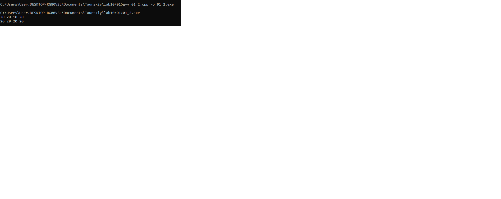
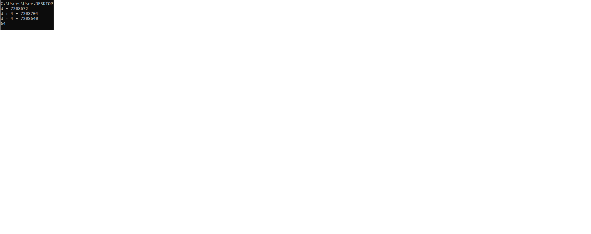
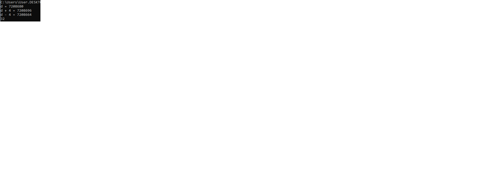
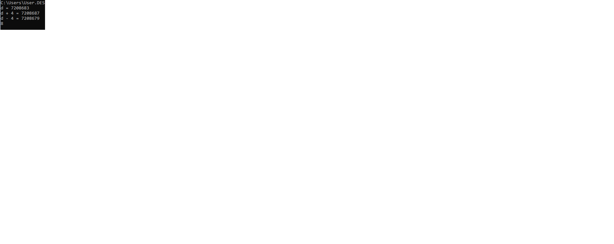

# Языки программирования
## Лабораторная работа 10

### Задание 1 **(2)**

*Рассмотрите следующие фрагменты программ. Запишите, что означают символы* **&** и  * *в каждом случае применения.*
```
int a = 10, b = 20;
int *p = &a , *q = &b;
p = q;
std::cout << *p <<' '<< *q << std::endl;
```
```
int a = 10, b = 20;
int *p = &a , *q = &b;
*p = *q;
std::cout << *p <<' '<< *q << std::endl;
```
*Чем различаются присваивания в третьей строке? Что можно вывести,
чтобы показать различия?*

*Примеры программ сохраните в папке с номером задания. Скриншоты работы прикрепите к отчету.*

**Ответ:**

* * - это указатель
* & - это указатель со взятием адреса

```
include <iostream>
int main(){
	{
	int a = 10, b = 20;
	int *p = &a , *q = &b;
	p = q;
	std::cout << *p <<' '<< *q << ' ' << a << ' ' << b << std::endl;
	}
	{
        int a = 10, b = 20;
	int *p = &a , *q = &b;
	*p = *q;
	std::cout << *p <<' '<< *q << ' ' << a << ' ' << b << std::endl;
	}

}  
 
```




### Задание 2 **(1)**

*Рассмотрим следующую программу.* 
```
double x[10];
for (int i = 0; i <10; i++)
    std::cout << &x[i] << std::endl;
```
*Что она выводит? Измените
вывод так, чтобы адреса выводились в десятичной системе счисления.
Объясните почему числа составляют арифметическую прогрессию с
определенным шагом.*

*Записанную программу сохраните в папке с номером задания.*
*Скриншоты работы прикрепите к отчету.*

**Ответ:**
```
include <iostream>
int main(){
double x[10];
for (int i = 0; i <10; i++)
    std::cout << &x[i] << ' ' << reinterpret_cast<size_t>(&x[i]) << std::endl;
}
```



### Задание 3 **(2)**
*Токен* **«*»** *в языке C++ может использоваться в трех различных
случаях. Аналогично токен* **«&»** *также может использоваться в трех
случаях. Приведите пример одной программы в которой они были бы
использованы во всех случаях.*

*Записанную программу сохраните в папке с номером задания.*

**Ответ:**

```
#include <iostream>

int main() {
    int a = 6, b = 3;
    int *p = &a;
    int &r = b;
    int res = (*p) * (r & b);
    std::cout << res << std::endl;
    return 0;
}
```

### Задание 4 **(2)**

*Выпишите значения всех переменных, в том числе указателей,
после выполнения каждой инструкции программы. Объясните, что
происходит в результате выполнения каждой инструкции.*
```
unsigned a = 8, b = 3 ,c = 17;
unsigned *p = &a;
unsigned *q = &b;
*p += *q + c;
c = *q;
p = &c;
c += a;
*p += 10;
*q = *p;
q = p ;
*q += 10;
```

**Ответ:**

### Задание 4

* unsigned a = 8, b = 3, c = 17 - создаются переменные со значениями a = 8, b = 3, c = 17
* unsigned *p = &a - создается указатель p, он запоминает адрес переменной a (a = 8, b = 3, c = 17, p = &a)
* unsigned *q = &b - создается указатель q, он запоминает адрес переменной b (a = 8, b = 3, c = 17, p = &a, q = &b)
* *p += *q + c - к значению по указателю p (a) прибавляются значение по указателю q (b) и c, переменная a становится равна 8 + 3 + 17 = 28 (a = 28, b = 3, c = 17, p = &a, q = &b)
* c = *q - в c записывается значение по указателю q (b), то есть 3 (a = 28, b = 3, c = 3, p = &a, q = &b)
* p = &c - указатель p теперь хранит адрес переменной c (a = 28, b = 3, c = 3, p = &c, q = &b)
* c += a - к c прибавляется a: 3 + 28 = 31 (a = 28, b = 3, c = 31, p = &c, q = &b)
* *p += 10 - к значению по указателю p (сейчас это c) прибавляется 10: 31 + 10 = 41 (a = 28, b = 3, c = 41, p = &c, q = &b)
* *q = *p - в переменную по указателю q (b) записывается значение по указателю p (c = 41) (a = 28, b = 41, c = 41, p = &c, q = &b)
* q = p - указатель q получает тот же адрес, что и p, теперь оба указателя смотрят на c (a = 28, b = 41, c = 41, p = &c, q = &c)
* *q += 10 - к значению по указателю q (c) прибавляется 10: 41 + 10 = 51 (a = 28, b = 41, c = 51, p = &c, q = &c)


### Задание 5 **(1)**
                                                                                
*Что сравнивается в приведенной ниже программе? Как можно
изменить первую строчку программы, чтобы результат тоже
изменился?*
```
int x = 1, y = 2;
int *p = &y, *q = &x;
if (p < q)
    std::cout << "Yes";
else
    std::cout << "No";
```

**Ответ:**

Сравниваются адреса переменных

```
include <iostream>
int main(){
int y = 2, x = 1;
int *p = &y, *q = &x;
if (p < q)
    std::cout << "Yes";
else
    std::cout << "No";
}

```

### Задание 6 **(2)**

*Объясните работу следующей программы. Как изменится
результат, если тип* **double** *изменить на некоторый другой, например*
**int** *или* **char**?
```
double x = 0;
double *d = &x;
std::cout << reinterpret_cast<size_t>(d + 4) - reinterpret_cast<size_t>(d - 4) << std::endl;
```





### Задание 7 **(2)**

*Объясните работу следующей программы. Как изменится
результат, если тип* **double** *изменить на некоторый другой, например*
**int** *или* **char**?
```
std::cout << reinterpret_cast <double*>(3000) - reinterpret_cast <double*>(2000) << std::endl;
```

**Ответ:**

* reinterpret_cast<double> превращает 3000 и 2000 в double, размер double 8 байтов, программа вычислит (3000 - 2000) / 8, в ответ выведется 125
* размер int 4 байта, программа посчитает (3000 - 2000) / 4 и выведет ответ 250
* размер char 1 байта, программа посчитает (3000 - 2000) / 1 и выведет ответ 1000


### Задание 8 **(2)**

*Что надо дописать в записанной ниже программе вместо многоточий, чтобы
она выводила все числа из массива* **a**? *Почему?*
```
int a[20];
for ( int i = 0; i < 20; i++)
    a[i] = i;
int *b=a + 8;
for (int i =...; i <...; i++)
    std::cout << b[i] <<' ';
```

**Ответ:**

```
int main(){
int a[20];
for ( int i = 0; i < 20; i++)
    a[i] = i;
int *b=a + 8;
for (int i = -8 ; i < 12 ; i++)
    std::cout << b[i] <<' ';
}
```

### Задание 9 **(2)**

*Что выводит следующая программа? Изменится ли результат если
изменить тип элементов массива?*

```
int a[10];
std::cout << &a[8] - &a[3] << std::endl;
```

**Ответ:**

* Программа выводит 5, если изменить тип массива, то результат останется прежним, потому что также меняется и расстояние в байта, и размер одного элемента 

### Задание 10 **(1)*

*Есть ли разница между инициализацией* **p** и **q** *в следующей программе? Обоснуйте ответ.*
```
int x [10]={1, 2, 3, 4, 5, 6, 7, 8, 9, 10};
int *p = x + 5;
int *q = &x[5];
```

**Ответ:**

* РАзницы между *p* и *q* нет, x - это адрес первого элемента массива, запись x + 5 сдвигает его на 5 элементов вперед, &x[5] и x + 5 дают одинаковый результат


### Задание 11 **(3)**

*Указатели можно использовать для итерации по массивам.
Напишите программу, которая найдет сумму элементов массива,
используя указатели. В начале цикла указатель требуется установить
на начало массива, в конце каждой итерации смещать его к
следующему элементу массива через инкремент. Для выхода из цикла
надо проверять, что указатель дошел до конца массива.*
```
int x [10]={1, 2, 3, 4, 5, 6, 7, 8, 9, 10};
int s = 0;
for (int *p = ...; ...; ...)
    s += ...
std::cout << s;
```

*Записанную программу сохраните в папке с номером задания.*

**Ответ:**

```
#include <iostream>

int main() {
    int x[10] = {1, 2, 3, 4, 5, 6, 7, 8, 9, 10};
    int s = 0;
    for (int *p = x; p < x + 10; p++)
        s += *p;
    std::cout << s;
    return 0;
}
```


## Дополнительные задания

### Задание 1 **(3)**

*Запишите программу на С++, в которой будет создаваться двумерный массив* **x[10][10]**. *Выведите адреса элементов массива и нарисуйте, как элементы расположены в памяти.*

### Задание 2 **(3)**

*Запишите программу на С++, в которой будет создаваться двумерный массив* **x[10][10]**. *Проверьте, что произойдет при различных выходах за границы массива. Напишите программы для демонстрации и поясните
их работу.* 
